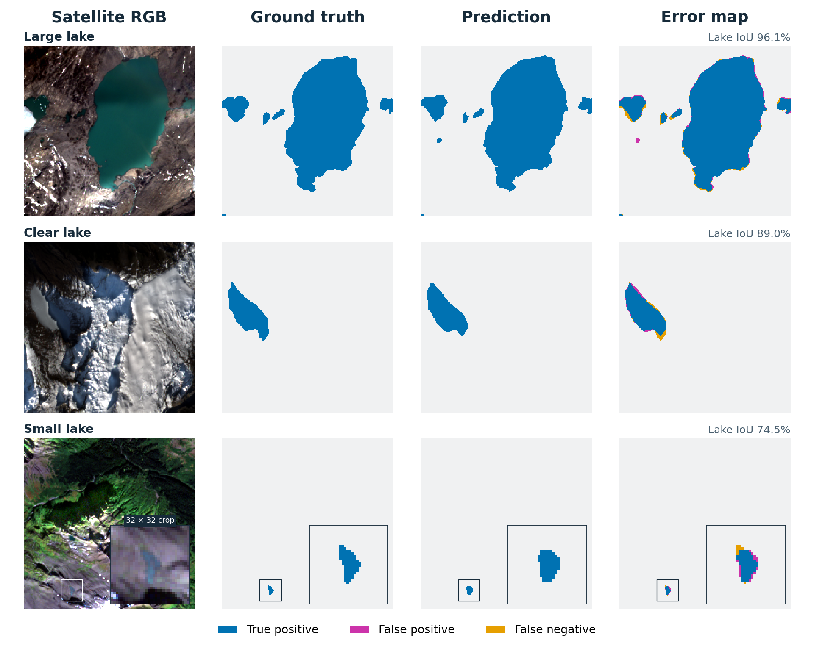

# GlacioLens

[](https://github.com/AliSajedifar/GlacioLens/actions/workflows/cpu.yml) [](https://huggingface.co/MaxiWb/glaciolens-glb-v1) [](LICENSE)

**Multimodal glacial lake mapping with spatial refinement and reproducible evaluation**

GlacioLens maps glacial lakes from optical/SAR imagery and physical elevation using a fine-tuned **TerraMind-Large encoder**, **UPerNet decoder** and a custom spatial refinement pathway. The system is designed to improve small-lake recovery and shoreline delineation on the original image grid.

**87.84% two-class mIoU · 76.76% lake IoU · 1,913 recorded GLB TEST tiles**

[Results](docs/results.md) · [Reproduce results](results/reproduction/README.md) · [Try real examples](docs/native_demo.md) · [Model weights](https://huggingface.co/MaxiWb/glaciolens-glb-v1) · [Method](docs/method.md)



**Selected successful examples:** large, clear and small lakes, using original released-model predictions. Illustrative selections, not a statistical sample. Imagery and labels: [Glacial-Lake-Bench](https://zenodo.org/records/17917359), [CC BY 4.0](https://creativecommons.org/licenses/by/4.0/).

<details>
<summary>Case IDs, rendering and attribution</summary>

From top to bottom: `GL_S2A_22WDT_20200717_0_L2A_146`, `NZ_S2B_59GLM_20200814_1_L2A_1`, and `AK_S2A_9VVC_20200909_0_L2A_231`. Each row retains native 256 × 256 context, with the same small-lake crop across all four columns. RGB uses stored Red/Green/Blue slots 2/1/0 and a per-band 2nd–98th percentile display stretch. Labels and predictions are not altered or resampled for scoring.

[Exact provenance, crop coordinates and counts](docs/figures/glaciolens_qualitative.json) · [Portable rendering script](tools/render_qualitative.py) · [Dataset and provider attribution](THIRD_PARTY_NOTICES.md#glb-and-glbc-data-attribution). The [results guide](docs/results.md#error-analysis) retains access to the difficult missed-extent case and measured tradeoffs.

</details>

## What I built

- **Multimodal integration and fine-tuning.** Fine-tuned a ~319M-parameter TerraMind-Large/UPerNet system combining optical imagery, stored SAR channels and physical elevation.
- **Custom spatial refinement.** Built a compact **57,249-parameter** residual pathway that combines local image detail with live decoder features during the same forward pass.
- **Task-specific training.** Integrated small-object and hard-negative objectives with fixed supplementary sampling for glacial lake segmentation.
- **Reproducible evaluation and inference.** Released model weights, a GeoTIFF prediction CLI, an exact three-case input/output example, and CPU tools that rebuild the measured comparison tables from public saved masks.

[Engineering decisions and contribution details](docs/project_overview.md). TerraMind and UPerNet are credited upstream architectures; this project integrates and adapts them for the task.

## Results

**GlacioLens-GLB-v1 scores 87.84% two-class mIoU on GLB TEST, above all 15 GLB scores reported in [Cryo-Bench v5, Table VIII-B](https://arxiv.org/html/2603.01576v5#S5.T8a).** The highest reported comparator is TerraMind at **83.97%**, a difference of **+3.87 percentage points**.

| Evaluation population | Tiles / observations | Two-class mIoU | Lake IoU |
|---|---:|---:|---:|
| GLB validation | 1,912 | 88.59% | 78.26% |
| **GLB test** | **1,913** | **87.84%** | **76.76%** |
| Dependent GLBC stress cohort | 1,105 | 83.75% | 69.06% |

### Small lakes and boundaries

| Measure on the same recorded TEST tiles | Released frozen-encoder TerraMind | GlacioLens | Change |
|---|---:|---:|---:|
| Boundary F1 | 64.22% | **74.23%** | **+10.01 pp** |
| Tiny targets reaching at least 50% ground-truth coverage | 20 / 275 | **143 / 275** | +123 targets |

Tiny targets are complete 16–63-pixel ground-truth objects. Coverage measures the fraction of each target covered by the prediction. [Detailed results](docs/results.md#small-lakes-boundaries-and-false-detections) include object F1, other references, false-detection tradeoffs and uncertainty intervals.

The published-score comparison uses additional DEM input and a different training recipe. Small-lake and boundary comparisons use the released frozen-encoder TerraMind reference. See the [results guide](docs/results.md) for evaluation details.

## Try GlacioLens

```sh
git clone https://github.com/AliSajedifar/GlacioLens.git
cd GlacioLens
```

### Reproduce the results on CPU

Rebuild the four measured TEST comparisons and their uncertainty intervals from the published masks. No checkpoint, satellite download or GPU is needed. **Prerequisite: Python 3.11+.** Use a separate CPU Python environment and run these commands from the repository root:

```sh
python -m pip install -e .
python -m pip install numpy==2.3.5 scipy==1.17.0
python tools/reproduce_results.py --output artifacts/reproduced_results
```

The output includes comparison tables, intervals and a verification record. [Results reproduction guide](results/reproduction/README.md).

### Run the three-case example

*Recorded NVIDIA L4 setup*

Try the model with three ready-to-use satellite images, aligned elevation/support files and expected masks. Start with the [three-case example guide](docs/native_demo.md): it covers the verified download, checkpoint, L4 setup, prediction and output comparison.

Download, input checks and output comparison run on CPU; model inference uses the recorded NVIDIA L4 environment. The example preserves the qualified input order and batches. For your own imagery, follow the [inference guide](docs/inference.md).

Installation exercises and metadata tools are in the [CPU quickstart](docs/quickstart.md). [Method and training reproduction](docs/reproduction.md) document the recorded recipe and exact split/sampling metadata; a portable end-to-end training launcher is not yet supplied.

## Research scope

Results reflect one final seed on the recorded GLB split, with historical development exposure. See the [model card](MODEL_CARD.md#limitations-and-tradeoffs) for the full evaluation protocol and generalization scope.

## Citation

If you use GlacioLens in your research, please cite this software using GitHub's **Cite this repository** button ([citation metadata](CITATION.cff)) or the [citation guide](docs/citation.md). The guide explains how to record the source and model revisions used and acknowledge upstream work.

## License, attribution and maintainer

Created and maintained by [Ali Sajedifar](https://github.com/AliSajedifar). Source and released model weights are available under **[Apache-2.0](LICENSE)**. Imagery, labels and elevation products retain their own terms. See [third-party notices](THIRD_PARTY_NOTICES.md) and [citation guidance](docs/citation.md).
