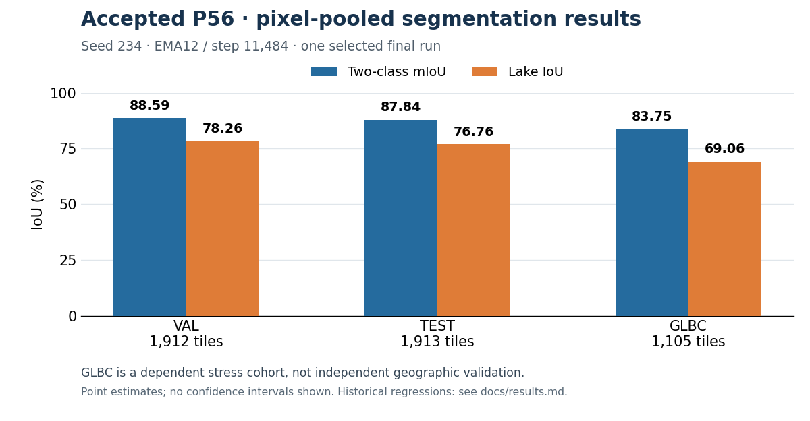

# GlacioLens: TerraMind-Based Multimodal Glacial Lake Segmentation

**GlacioLens** maps glacial lakes from satellite imagery and elevation data. Lake outlines help describe the extent of water in changing mountain landscapes; separating small lakes from bright terrain and tracing complex shorelines are challenging segmentation problems.

The project combines **TerraMind-Large and UPerNet** with six optical channels, two stored SAR channels and physical elevation. A learned spatial residual joins local image detail with live decoder context on the original 256×256 grid. The training recipe combines dense segmentation, component-focused losses and fixed supplementary sampling. [Method and source map](docs/method.md) explain these integration choices and credit the upstream architectures; the final score does not isolate the benefit of an individual component.

## Measured result

**GlacioLens-GLB-v1 achieved 87.8373% two-class mIoU and 76.7644% lake IoU on the recorded GLB TEST split of 1,913 tiles.** The accepted P56 run completed 24 epochs and 22,968 updates, with full-validation selection of EMA12 at step 11,484.



The figure shows the accepted release's point estimates, rounded to two decimals. On the dependent GLBC stress cohort of 1,105 observations, two-class mIoU is **83.7493%** and lake IoU is **69.0553%**. [Full-precision results](docs/results.md) define the metrics, report historical regressions and explain uncertainty and comparison scope.

**Research scope:** one final seed, historical TEST exposure, shared acquisitions/aliases and a dependent GLBC cohort limit generalization claims. Small-object gains coexist with extra false-positive area and large/border extent losses. These results do not establish independent geographic robustness or production readiness.

## Start here

Get the [public source](https://github.com/AliSajedifar/GlacioLens), maintained by **Ali Sajedifar** ([AliSajedifar](https://github.com/AliSajedifar)):

```sh
git clone https://github.com/AliSajedifar/GlacioLens.git
cd GlacioLens
```

- **Explore the project:** read the [project overview](docs/project_overview.md) for the problem, implementation decisions and evidence, or the [model card](MODEL_CARD.md) for the release identity and intended use.
- **Run the tools without private assets:** follow the [CPU quickstart](docs/quickstart.md). It installs the lightweight package, creates tiny synthetic masks and runs the real `recount` command. Expected counts are **TP=3, FP=2, FN=1, TN=6**, giving lake IoU **0.5** and two-class mIoU **0.5833333333**. This demonstrates tooling and metric operation, not trained-model prediction quality. It needs no imagery, weights or GPU.
- **Predict with authorized local assets:** follow the [native-inference guide](docs/inference.md). Supply the exact selected checkpoint and fully valid, registered 11-band 256×256 images, aligned physical DEM metres and genuine usable support. The route uses the recorded NVIDIA L4 stack and writes georeferenced masks plus a receipt; no labels are required.

The source provides a Python package, CPU inspection/evaluation tools, the native prediction CLI/API and documented research components. **[GlacioLens-GLB-v1 weights are public on Hugging Face](https://huggingface.co/MaxiWb/glaciolens-glb-v1) under Apache-2.0.** Download the original selected P56 checkpoint using the [pinned download instructions](docs/inference.md#checkpoint-download), then supply valid local imagery and DEM. A source copy alone does not include the weights or data. See [release status](docs/release_status.md#owner-decisions).

The existing software names remain `glacial-lake` for the distribution/CLI and `glacial_lake` for Python imports. The [technical identity map](MODEL_CARD.md#intended-use-and-identity) connects the GlacioLens display name to the recorded checkpoint and runtime provenance.

## Reproduce and inspect

The [reproduction guide](docs/reproduction.md) specifies image bands, DEM preparation, normalization, training populations, optimization and validation selection. It records the completed method; a portable end-to-end training launcher is not supplied. The [recipe](configs/p56_recipe.json), [model identity](results/model_identity.json) and [source provenance](release/source_provenance.json) provide the precise technical records.

Full P56 scientific evaluation and software interface qualification have different scopes. The original P61 installed CLI matched three retained masks exactly on L4, using the prescribed pair and singleton. Later setup/preflight maintenance was CPU-verified; the current source snapshot has not been newly executed on L4. [Release status](docs/release_status.md#exercised-environment) preserves those boundaries.

## License and citation

Owner-controlled source, documentation and the aggregate-results figure are released under [Apache-2.0](LICENSE). The selected P56 weights are also licensed Apache-2.0 by the maintainer; imagery, labels and DEM products retain their own terms. Read [third-party notices](THIRD_PARTY_NOTICES.md), [licensing scope](docs/release_status.md#licensing-scope) and [citation guidance](docs/citation.md) before reuse. The source repository is maintained by Ali Sajedifar. No package-index release or DOI is claimed.
