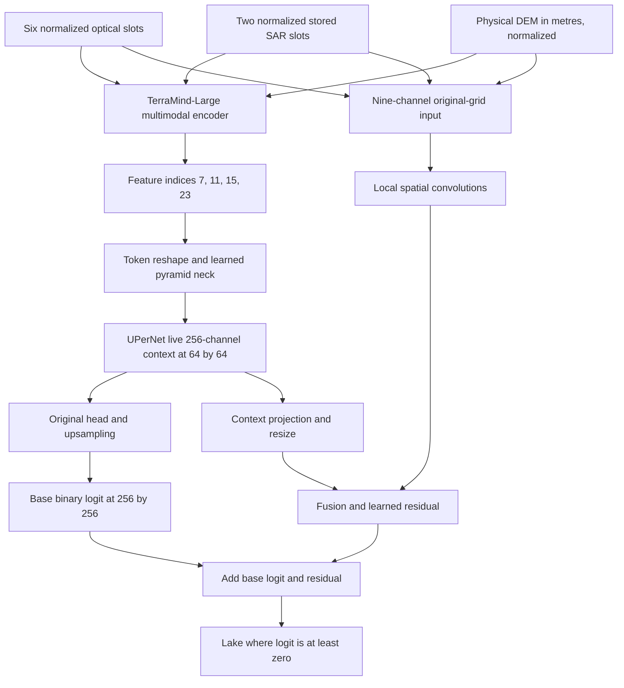

# GlacioLens method and source map

GlacioLens predicts a binary lake logit on the original 256×256 grid. TerraMind-Large and UPerNet are upstream components. This repository integrates their multimodal inputs, audited initialization, joint spatial residual, component-focused objectives and fixed auxiliary curriculum. No isolated causal gain is attributed to any one component by the accepted single-seed result.

## Data flow

The DEM enters **both** TerraMind's native DEM modality embedding and the nine-channel local spatial branch. It is not merely a postprocessing feature. Optical, stored SAR and DEM use separate modality inputs (`S2L2A`, `S1GRD`, `DEM`) in the base model; SAR physical semantics remain provisional. The selected configuration merges modalities with `mean` and uses the named feature/neck sequence in [the recipe](../configs/p56_recipe.json).

`JointSpatialPath` projects the nine channels through 9→32→32 convolutions (the second downsamples to 128×128). It projects the live UPerNet context 256→32, resizes it to 128×128, concatenates to 64 channels, fuses and predicts a one-channel residual, then upsamples that residual to the native grid. The final residual convolution starts at zero. Binding captures the differentiable decoder output during the **same** base forward and checks its shape; it does not rerun or detach the base model. All 319,492,514 parameters train jointly, including 57,249 spatial parameters. GroupNorm replaces BatchNorm in new neck/decoder/head modules; backbone activation checkpointing preserves RNG behavior.

## Actual public interfaces

All paths below are under [src/glacial_lake](../src/glacial_lake/). The map covers computational components and the separate [native inference CLI/API](inference.md).

| File and callable | Purpose |
|---|---|
| `native_input.py`: `read_manifest`, `read_input` | Strict target-free local manifest and unchanged native raster/normalization contract |
| `native_inference.py`: `prepare_job`, `Predictor.predict_many` | Shared CPU preparation, exact selected-state restore and ordered pair/tail GeoTIFF prediction |
| `data.py`: `read_registered_image`, `read_tile`, `normalized_inputs`, `TileDataset` | Selected image slots, paired target support and frozen normalization |
| `p17_data.py`: `NativeDEMDataset(..., dem_root=...)` | Explicit original-grid physical DEM sidecar |
| `p56_native_data.py`: `ComponentDataset`, `collate_regions` | Seed234 native D4 geometry and component regions |
| `model.py`: `build_model(config, checkpoint_path, resume=False)`, `optimizer_groups` | Upstream factory integration, pretrained tensor audits and complete optimizer coverage |
| `p22_spatial.py`: `JointSpatialPath`; `p56_spatial_binding.py`: `install_spatial_path` | Actual residual graph and same-forward binding |
| `losses_metrics.py`: `segmentation_loss`, `pooled_metrics` | Valid-pixel dense loss and count-based metrics |
| `p23_loss.py`: `make_regions`, `component_auxiliary_loss` | TRAIN-only complete 16–255-pixel component regions |
| `p27_negative.py`: `make_negative_plans`, `negative_region_loss`, `negative_coefficient` | Eligible large false-region auxiliary and epoch ramp |
| `p56_data.py`: `build_pools`, `build_plan`, `AuxiliaryDataset` | Fixed source-balanced supplementary sampling and geometry |
| `p17_schedule.py`: `assign_next_lr`; `p17_ema.py`: `TensorEMA` | Per-update schedule and exponential moving average of parameters |
| `p56_selection.py`: `improves`, `history_winner` | Strict full-VAL class-mIoU selection and earliest exact ties |

Historical module prefixes preserve provenance; they do not identify multiple final models. A file that calls itself a “reference” component can still be a real dependency of the completed integration. [Source provenance](../release/source_provenance.json) identifies exact modules and path-adapted subsets. The public `build_model` alone does not bind the selected checkpoint or spatial path. The separate [P56-native-r1 interface](inference.md) composes those components, checks exact source/state identities and exposes the qualified prediction CLI.

## Objectives and sampling

Dense loss is valid-pixel binary cross-entropy plus mean Dice loss over samples with positive target pixels; an all-negative sample still contributes to BCE. The positive-region auxiliary balances local component foreground/background BCE and local Dice, with images lacking eligible objects contributing zero. Eligibility uses complete 8-connected TRAIN objects of 16–255 pixels, a 16-pixel context margin and minimum 64-pixel window; other components are not relabeled as background.

The negative-region auxiliary uses detached current TRAIN predictions to identify 8-connected regions of at least 256 pixels with at most 10% target-positive area. It excludes invalid-touching regions, retains border regions and applies gradients only to eligible ground-truth-background logits. It neither removes false detections at inference nor changes labels.

Native loss is `dense + 0.20 * positive + negative_coefficient(epoch) * negative`. The negative coefficient is 0 for epochs 1–2, then 0.025, 0.05, 0.075 and 0.10 for epochs 3–6, staying at 0.10. Supplementary dense loss contributes 0.25 times the mean over auxiliary pairs.

The auxiliary roles are TINY (complete 16–63 pixels), SMALL (complete 64–255), COMPLETE and EDGE (>=256 without invalid contact, with or without image-edge contact). Larger roles balance requested 256–4095 and >=4096 area cells. Source image selection precedes anchor selection; an empty requested cell falls back within the same role while retaining the requested-cell record. Fixed historical RNG strings deliberately remain unchanged. Tiny/small windows are 128×128 with available context; inputs enlarge to 256×256 with FP32 bilinear interpolation, usability uses nearest-neighbor, and logits are average-pooled back to the unresized target grid. The shared auxiliary plan is fixed across the final run.

See [recorded training](reproduction.md#recorded-training-and-selection) for update/tail arithmetic, optimizer, EMA and selection, and the [executed update excerpt](training_update.md) for the exact objective accumulation. These mechanisms were implemented and jointly evaluated; this result does not establish separate ablations of their effects.
